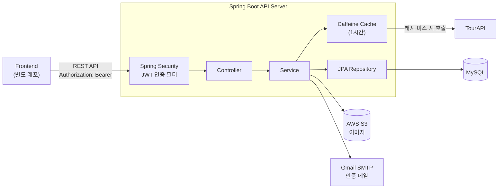
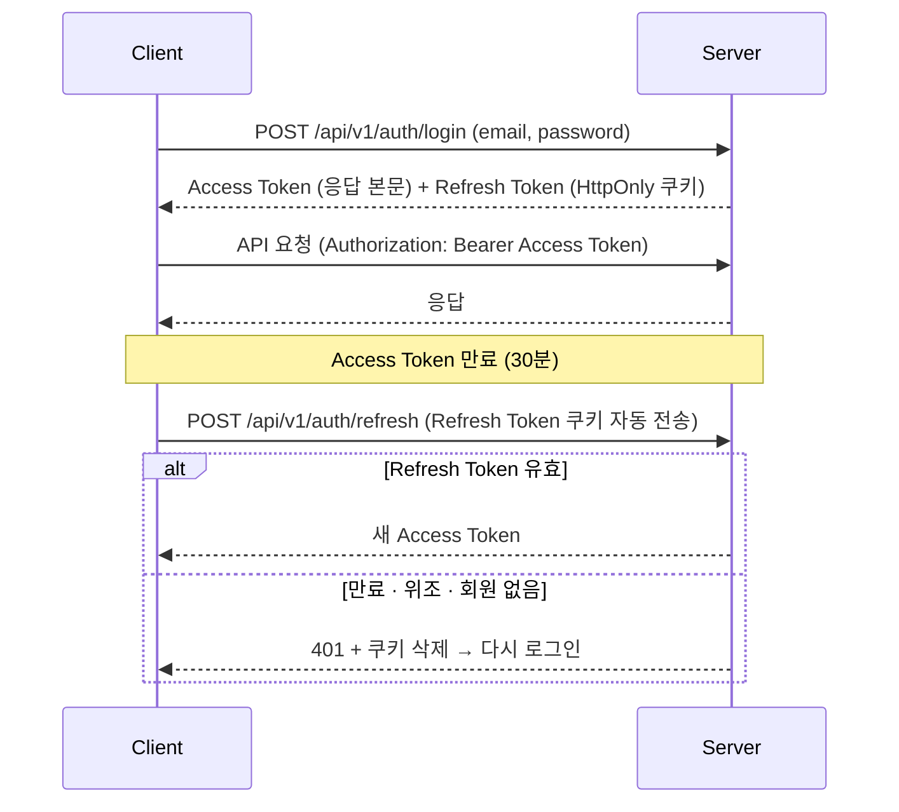

# WayLog — 전국 여행 정보 & 여행 피드 플랫폼 (Backend)

> 한국관광공사 TourAPI로 지역별 여행지, 축제, 여행코스를 보여주고, 사용자가 여행 사진과 후기를 공유하는 웹 서비스의 백엔드 서버입니다.

- **기간**: 2026.08.20 ~ 2026.09.02 (2주) · 국비 자바 풀스택 과정 중간 프로젝트
- **인원**: 4명 (백엔드 2, 프론트엔드 1, ERD 설계 지원 1)
- **구조**: 프론트엔드와 백엔드 레포를 분리한 REST API 서버

<br>

## 담당 역할 — 백엔드 팀장 [@hardtack6348](https://github.com/hardtack6348)

| 분야 | 내용 |
| --- | --- |
| 프로젝트 세팅 | Spring Boot 초기 세팅, MySQL 연동, 회원·북마크·팔로우 등 도메인 엔티티 설계 |
| 인증 / 보안 | Spring Security + JWT 인증, 회원가입·로그인·로그아웃·토큰 재발급, 이메일 인증, 비밀번호 재설정 |
| 게시판 | 공지사항 게시판과 댓글 CRUD, 키워드 검색과 페이징, 조회수 |
| 여행 정보 | TourAPI 기반 여행코스 API, 시·도 / 시·군·구 지역 코드와 관광 분류코드 조회 |
| 리팩터링 | 인증 로직 보안 취약점 수정과 단위 테스트 작성 ([#6](https://github.com/hardtack6348/travel_korea/pull/6), [#7](https://github.com/hardtack6348/travel_korea/pull/7)) |

팀원 담당: TourAPI 연동 클라이언트와 여행지·상세 페이지, 여행 피드(SNS), S3 이미지 업로드, 여행지 북마크

<br>

## 기술 스택

| 분류 | 기술 |
| --- | --- |
| Language | Java 17 |
| Framework | Spring Boot 4, Spring Security, Spring Data JPA, Spring Validation |
| Auth | JWT (nimbus-jose-jwt, HS256), BCrypt, JavaMailSender (Gmail SMTP) |
| Database | MySQL, H2 (테스트) |
| Cache | Caffeine |
| Infra | AWS S3 |
| External API | 한국관광공사 TourAPI 4.0 (KorService2) |
| Test | JUnit 5, Mockito |
| Build | Maven |

<br>

## 아키텍처



<br>

## 인증 흐름



- **Access Token**: 응답 본문으로 전달, 유효기간 30분
- **Refresh Token**: `HttpOnly` · `Secure` · `SameSite=Strict` 쿠키로 전달, 유효기간 7일. JavaScript에서 읽을 수 없어 XSS로 탈취되기 어렵고, 다른 사이트에서 보낸 요청에는 쿠키가 실리지 않습니다.
- URL별 접근 권한: 비회원 조회 허용(여행 정보, 공지사항, 피드 조회), 회원 전용, 관리자 전용(`/api/v1/admin/**`)

<br>

## 주요 기능

| 기능 | 설명 |
| --- | --- |
| 회원 | 회원가입, 로그인/로그아웃, 토큰 재발급, 이메일·닉네임 중복 확인 |
| 이메일 인증 | 인증번호 발송(3분 만료), 확인(5회 제한), 회원가입 / 비밀번호 재설정 용도 구분 |
| 여행 정보 | 메인 추천 여행지와 여행코스, 지역·분류별 검색, 축제 목록, 여행지 상세 |
| 여행 피드 | 사진 게시글 등록·수정·삭제, 좋아요, 북마크, 피드 프로필 |
| 북마크 | 여행지 북마크 추가·해제, 목록 조회 |
| 공지사항 | 관리자 공지 등록·수정·삭제(이미지 첨부), 목록 검색과 페이징, 댓글 |

<details>
<summary><b>API 목록</b></summary>

| Method | URI | 설명 | 권한 |
| --- | --- | --- | --- |
| POST | `/api/v1/auth/signup` | 회원가입 (이메일 인증 필요) | 전체 |
| POST | `/api/v1/auth/login` | 로그인 | 전체 |
| POST | `/api/v1/auth/logout` | 로그아웃 | 전체 |
| POST | `/api/v1/auth/refresh` | Access Token 재발급 | 전체 |
| POST | `/api/v1/auth/email-verification` | 회원가입 인증번호 발송 | 전체 |
| POST | `/api/v1/auth/email-verification/confirm` | 인증번호 확인 | 전체 |
| POST | `/api/v1/auth/password-reset-requests` | 비밀번호 재설정 인증번호 발송 | 전체 |
| PUT | `/api/v1/auth/password` | 비밀번호 변경 (이메일 인증 필요) | 전체 |
| GET | `/api/v1/users/check-email` | 이메일 중복 확인 | 회원 |
| GET | `/api/v1/users/check-nickname` | 닉네임 중복 확인 | 회원 |
| GET | `/api/v1/home` | 메인 추천 여행지·여행코스 | 전체 |
| GET | `/api/v1/search` | 여행지 검색 | 전체 |
| GET | `/api/v1/regions` | 시·도 목록 | 전체 |
| GET | `/api/v1/regions/districts` | 시·군·구 목록 | 전체 |
| GET | `/api/v1/classifications` | 관광 분류코드 | 전체 |
| GET | `/api/v1/festivals` | 축제 목록 | 전체 |
| GET | `/api/v1/tour/contents/{contentId}` | 여행지 상세 | 전체 |
| GET | `/api/v1/tour-bookmarks` | 여행지 북마크 목록 | 회원 |
| POST | `/api/v1/tour-bookmarks/toggle` | 여행지 북마크 추가·해제 | 회원 |
| GET | `/api/v1/feed/posts` | 피드 목록 | 전체 |
| GET | `/api/v1/feed/posts/{postId}` | 피드 상세 | 전체 |
| POST | `/api/v1/feed/posts` | 피드 등록 | 회원 |
| PUT | `/api/v1/feed/posts/{postId}` | 피드 수정 | 회원 |
| DELETE | `/api/v1/feed/posts/{postId}` | 피드 삭제 | 회원 |
| POST | `/api/v1/feed/posts/{postId}/likes` | 좋아요 | 회원 |
| POST | `/api/v1/feed/posts/{postId}/bookmarks` | 피드 북마크 | 회원 |
| GET | `/api/v1/feed/profile` | 피드 프로필 조회 | 회원 |
| PATCH | `/api/v1/feed/profile` | 피드 프로필 수정 | 회원 |
| GET | `/api/v1/notices` | 공지사항 목록 (검색, 페이징) | 전체 |
| GET | `/api/v1/notices/{noticeId}` | 공지사항 상세 | 전체 |
| POST | `/api/v1/admin/notices` | 공지사항 등록 | 관리자 |
| PUT | `/api/v1/admin/notices/{noticeId}` | 공지사항 수정 | 관리자 |
| DELETE | `/api/v1/admin/notices/{noticeId}` | 공지사항 삭제 | 관리자 |
| GET | `/api/posts/{postId}/comments` | 댓글 목록 | 회원 |
| POST | `/api/posts/{postId}/comments` | 댓글 작성 | 회원 |
| PUT | `/api/comments/{commentId}` | 댓글 수정 | 회원 |
| DELETE | `/api/comments/{commentId}` | 댓글 삭제 | 회원 |

</details>

<br>

## 트러블슈팅

### 1. 이메일만 알면 다른 사람의 비밀번호를 바꿀 수 있던 문제 ([#7](https://github.com/hardtack6348/travel_korea/pull/7))

**문제**
`PUT /api/v1/auth/password`가 이메일과 새 비밀번호만 받아 바로 변경하고 있었습니다. 인증번호 확인 API는 성공 여부만 응답하고 결과를 기록하지 않아, 회원가입도 인증 없이 가능했습니다.

**해결**
- 인증에 성공하면 이메일과 용도(`SIGNUP`, `PASSWORD_RESET`)를 함께 기록하고, 회원가입과 비밀번호 변경은 같은 이메일·같은 용도로 인증한 경우에만 처리
- 인증은 1회만 사용, 인증 후 10분 안에 완료해야 함
- 인증번호 입력 5회 초과 시 차단, `Random` 대신 `SecureRandom` 사용
- 인증 상태는 세션에 저장했습니다. 3분짜리 임시 상태이고 서버가 한 대이므로 세션으로 충분하다고 판단했고, 서버를 늘리면 Redis(TTL)로 옮길 계획입니다.

### 2. 만료된 Refresh Token으로 토큰이 재발급되던 문제 ([#6](https://github.com/hardtack6348/travel_korea/pull/6))

**문제**
토큰 재발급 시 Refresh Token이 만료되었으면 오히려 Access/Refresh Token을 모두 새로 발급하고 있었습니다. Refresh Token이 탈취되면 만료와 관계없이 계속 로그인 상태를 유지할 수 있었습니다.

**해결**
- 서명, 타입, 만료를 모두 검증하고, 하나라도 실패하면 401과 함께 쿠키를 삭제해 다시 로그인하도록 변경
- 토큰이 유효해도 탈퇴 등으로 회원이 없으면 재발급하지 않음
- 만료·위조·타입 오류 케이스를 단위 테스트로 검증

### 3. 세션 인증에서 JWT 인증으로 전환

교육 과정에서는 세션 인증을 배웠지만, 이 프로젝트는 프론트엔드와 백엔드가 분리된 구조였습니다. 모바일 환경 대응과 서버를 늘렸을 때의 세션 공유 문제를 고려해, 서버가 로그인 상태를 저장하지 않는 JWT 방식으로 전환했습니다.

### 4. 레포를 합치는 과정에서 DB 연결이 반복해서 실패한 문제

프론트엔드와 백엔드 레포를 분리해 개발하다 합치는 과정에서 DB 연결이 계속 실패했습니다. env 파일과 AWS 서버 설정을 점검해 DB 접속 정보를 환경 변수(`DB_URL`, `DB_USER`, `DB_PW`)로 분리하고 연결을 안정화했습니다.

### 5. TourAPI 일일 호출 제한 대응

TourAPI 개발 계정은 하루 1,000회까지만 호출할 수 있어, 요청마다 API를 호출하면 개발 중에도 한도를 쉽게 넘길 수 있었습니다. 같은 조건의 조회 결과를 Caffeine 캐시에 1시간 동안 저장해 같은 요청이 반복될 때 API를 다시 호출하지 않도록 했습니다. 시·도, 시·군·구 지역 코드와 관광 분류코드처럼 거의 바뀌지 않는 데이터는 JSON 파일로 서버에 두고 읽어 오도록 했습니다.

<br>

## 실행 방법

### 요구 사항
- JDK 17 이상
- MySQL

### 환경 변수

| 변수 | 설명 |
| --- | --- |
| `SERVER_PORT` | 서버 포트 |
| `DB_URL` / `DB_USER` / `DB_PW` | MySQL 접속 정보 |
| `JWT_SECRET` | JWT 서명 키 (HS256, 32바이트 이상의 무작위 문자열) |
| `MAIL_USERNAME` / `MAIL_PW` | Gmail 계정과 앱 비밀번호 |
| `TOUR_API` | 공공데이터포털 TourAPI 서비스 키 |
| `FRONTEND_ORIGEN` | CORS 허용 프론트엔드 주소 |
| `STORAGE_TYPE` | 이미지 저장소 (`s3`) |
| `S3_BUCKET` / `AWS_REGION` | S3 버킷 이름과 리전 |

### 실행

```bash
./mvnw spring-boot:run
```

TourAPI 키 없이 실행하려면 `local-mock` 프로필을 사용하세요. 실제 API 대신 목업 데이터를 반환합니다.

```bash
./mvnw spring-boot:run -Dspring-boot.run.profiles=local-mock
```

### 테스트

```bash
./mvnw test
```

<br>

## 프로젝트 구조

```
src/main/java/kr/co/mycom/travel_korea
├── config          # Security, JWT, 메일 설정
├── controller      # 인증, 회원, 북마크 API
├── service         # 인증, 회원 비즈니스 로직
├── entity          # 회원, 북마크, 팔로우 등 JPA 엔티티
├── repository
├── board           # 공지사항 게시판, 댓글, S3 저장소
├── feed            # 여행 피드 (SNS)
├── tour            # TourAPI 연동, 여행지·축제·지역·분류코드, 여행지 북마크
└── common          # 공통 예외 처리
```
